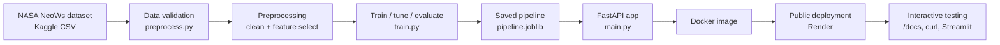

# NEO Sentinel

Predicts whether a near Earth object is hazardous, served as a FastAPI prediction API, trained on NASA's own Near Earth Object catalog.

## 1. Project proposal

**Value proposition:** NEO Sentinel turns raw NASA close-approach data into an instant hazard-risk screen, so an analyst can triage thousands of tracked objects without manually checking each one against NASA's hazard criteria.

**Problem:** NASA's Center for Near-Earth Object Studies tracks tens of thousands of asteroids. Deciding which ones merit closer orbital analysis is a resource allocation problem: analysts cannot deep-dive every object, so a fast, defensible first-pass risk screen has real value.

**Intended user:** A planetary defense analyst, researcher, or space-enthusiast developer who wants a quick, explainable hazard estimate from an object's physical and orbital parameters, before committing to a full orbital-mechanics analysis.

**Prediction target:** `hazardous` (boolean), NASA's own classification of whether an object is a Potentially Hazardous Object. The API returns a probability and a risk tier (low, moderate, elevated, high), supporting a triage decision rather than a final verdict.

**Why this is a strong entry-level portfolio piece:** it is a real binary classification problem on an imbalanced, authoritative dataset, with a complete and honest lifecycle: validated data in, a tuned and compared model, held-out test evaluation, a served prediction API with input validation, tests, a container, and a public deployment. Nothing here pretends the model replaces real orbital mechanics; it is explicitly scoped as a screening tool.

### Why this project over the alternatives

| Candidate | Why it loses to NEO Sentinel |
|---|---|
| House price / car price prediction | Generic, overdone, no recruiter differentiation |
| Titanic survival classifier | Toy dataset, no real-world decision attached |
| Water potability (WHO) | Known data-quality problems, heavy missing values, less interpretable |
| Student dropout prediction | Sensitive personal data, harder to source cleanly tonight |
| Credit risk scoring | Needs a dataset with access or licensing friction, higher stakes for an unvalidated model |
| **NEO Sentinel (chosen)** | Authoritative NASA source, clean documented schema, real decision workflow, safely scoped (a screening aid, not a launch decision) |

## 2. Dataset verification

- **Title:** NASA - Nearest Earth Objects
- **Source URL:** https://www.kaggle.com/datasets/sameepvani/nasa-nearest-earth-objects
- **Underlying origin:** NASA Open API, NeoWs (Near Earth Object Web Service), compiled into a static CSV
- **Size:** 90,836 rows, 10 columns
- **Format:** single CSV
- **Columns:** `id`, `name`, `est_diameter_min`, `est_diameter_max`, `relative_velocity`, `miss_distance`, `orbiting_body`, `sentry_object`, `absolute_magnitude`, `hazardous`
- **Target variable:** `hazardous` (boolean)
- **Access:** free, requires a Kaggle account and an API token; no payment, no restricted API key beyond that
- **License:** Kaggle dataset terms (attribution to NASA as original source); NASA Open Data itself is public domain
- **Known data quality notes:** `orbiting_body` is constant ("Earth") in this dataset and carries no signal; `sentry_object` is a near-constant flag; the target classes are imbalanced (hazardous objects are the minority class), which the modeling plan below accounts for directly

I have not executed the download in this environment; the schema and row count above are taken from the dataset's own published documentation. Running `src/download_data.py` or downloading manually is the verification step before training.

**Manual download (no code needed):**
1. Go to https://www.kaggle.com/datasets/sameepvani/nasa-nearest-earth-objects
2. Click Download, accept the terms if prompted
3. Unzip and place the CSV at `data/neo.csv`

## 3. Machine learning plan

- **Features used:** `est_diameter_min`, `est_diameter_max`, `relative_velocity`, `miss_distance`, `absolute_magnitude`
- **Dropped:** `id`, `name` (identifiers, no signal), `orbiting_body` (constant), `sentry_object` (near-constant, excluded to keep the feature set lean)
- **Leakage prevention:** all retained features are observational properties of the object itself (size, speed, distance, brightness), known independently of the hazard label; none are derived from or correlated with how NASA assigned the label after the fact
- **Missing values:** the documented dataset has none in these columns; the pipeline still drops any row missing a required field defensively, and logs how many
- **Categorical data:** none remain after dropping `orbiting_body`
- **Scaling:** `StandardScaler`, fit on training data only, reused at prediction time via the saved pipeline
- **Class imbalance:** handled with `class_weight="balanced"` (Logistic Regression, Random Forest) and `scale_pos_weight` (XGBoost), rather than oversampling, to keep the pipeline simple
- **Baseline model:** Logistic Regression
- **Candidate models:** Random Forest and XGBoost, each tuned with `RandomizedSearchCV` (10 iterations, 3-fold CV, scored on F1) on the training set
- **Validation and test strategy:** stratified 70 / 15 / 15 split into train, validation, test. Candidates are tuned on train and compared on validation. The single best model by validation F1 is refit on train+validation, then scored once on the untouched test set. That test score is the number reported as final.
- **Metrics:** precision, recall, F1, ROC-AUC, and the confusion matrix. F1 and recall matter most here: missing a genuinely hazardous object (a false negative) is the costlier error for a screening tool, so recall on the hazardous class is reported explicitly rather than only overall accuracy, which is misleading on an imbalanced dataset.
- **Hyperparameter tuning:** `RandomizedSearchCV` as above; kept to 10 iterations per model to fit the time budget
- **Model persistence:** the fitted `StandardScaler` and the winning classifier are saved together as one `sklearn.Pipeline` (`models/pipeline.joblib`), so the API cannot accidentally apply a scaler that does not match the model
- **Explainability:** model-native feature importance (`feature_importance.json`) always; a SHAP summary plot (`models/shap_summary.png`) as a best-effort extra when `shap` is installed

**No numbers are invented anywhere in this document.** Actual precision, recall, F1, and ROC-AUC values appear only in `models/metrics.json`, generated by running `src/train.py` against the real dataset.

## 4. System architecture



## 5. Implementation plan (4 to 6 hours)

| Time | Checkpoint |
|---|---|
| 0:00 to 0:20 | Download dataset, confirm schema matches `preprocess.py`, set up virtual environment |
| 0:20 to 0:40 | `pip install -r requirements.txt`, run `pytest tests/test_preprocessing.py` |
| 0:40 to 1:30 | Run `python src/train.py --data data/neo.csv`, inspect `models/metrics.json` |
| 1:30 to 2:00 | Run the API locally (`uvicorn app.main:app --reload`), test `/health`, `/predict`, `/docs` |
| 2:00 to 2:30 | Run `pytest tests/` end to end, fix anything red |
| 2:30 to 3:00 | Build and run the Docker image locally, re-verify the three endpoints |
| 3:00 to 4:00 | Deploy to Render, verify the live URL |
| 4:00 to 5:00 (optional) | Streamlit demo UI, screenshots, SHAP plot review |
| 5:00 to 6:00 (optional) | README polish, GitHub release, resume bullets filled with real numbers |

**Folder structure**
```
neo-sentinel/
  app/
    main.py
    schemas.py
    streamlit_app.py
  src/
    download_data.py
    preprocess.py
    train.py
  tests/
    conftest.py
    test_preprocessing.py
    test_api.py
  models/            (created by train.py)
  data/              (created by download_data.py; not committed)
  Dockerfile
  requirements.txt
  requirements-ui.txt
  .gitignore
  README.md
```

**Commands, start to finish**
```bash
python -m venv .venv && source .venv/bin/activate
pip install -r requirements.txt

python src/download_data.py          # or download manually, see section 2
python src/train.py --data data/neo.csv

uvicorn app.main:app --reload        # local API at http://localhost:8000/docs

pytest tests/
```

No environment variables are required to run locally. `PORT` is read at container start for PaaS compatibility, defaulting to 8000.

## 6. Working code

All files listed in the folder structure above are complete and executable, not pseudocode. Key design decisions:

- `src/preprocess.py` is imported by both `src/train.py` and `app/main.py`, so the exact same cleaning and validation logic runs at training time and prediction time.
- The saved `pipeline.joblib` bundles the fitted `StandardScaler` with the fitted classifier as one `sklearn.Pipeline`, so the API can never apply a mismatched scaler.
- `app/main.py` returns `503` on `/predict` if no trained pipeline exists yet, rather than crashing, with a clear message pointing at `train.py`.
- Tests cover: schema validation (missing columns, missing values, negative physical values), the diameter-ordering business rule, and the API (health check, a valid prediction, a negative-value rejection, a missing-field rejection, an inverted-diameter rejection, and the model-info endpoint). A `conftest.py` fixture trains a tiny synthetic pipeline for CI runs that happen before the real dataset is downloaded, and removes it afterward so it can never shadow a real trained model.

## 7. Public deployment (Render)

1. Push this repository to GitHub, with `data/` and `*.joblib` excluded (already handled by `.gitignore`) — **but commit the trained `models/pipeline.joblib`, `models/metrics.json`, and `models/feature_importance.json` explicitly**, since the API needs them at runtime and Render does not run your training script for you. (Force-add them: `git add -f models/pipeline.joblib models/metrics.json models/feature_importance.json`.)
2. On https://render.com, create a new **Web Service**, connect the GitHub repo.
3. Environment: **Docker**. Render detects the `Dockerfile` automatically.
4. Leave the start command blank; the `Dockerfile`'s `CMD` already binds to `$PORT`, which Render injects automatically.
5. Deploy. Render builds the image and gives you a public URL like `https://neo-sentinel.onrender.com`.
6. Verify:
   - `GET https://neo-sentinel.onrender.com/health`
   - `GET https://neo-sentinel.onrender.com/docs` (interactive Swagger UI)
   - `POST https://neo-sentinel.onrender.com/predict` with the example payload below

**Local Docker build and run**
```bash
docker build -t neo-sentinel .
docker run -p 8000:8000 neo-sentinel
curl http://localhost:8000/health
curl -X POST http://localhost:8000/predict \
  -H "Content-Type: application/json" \
  -d '{"est_diameter_min":0.1,"est_diameter_max":0.25,"relative_velocity":45000,"miss_distance":5000000,"absolute_magnitude":21.5}'
```

**Free-tier limitations:** Render's free web services spin down after 15 minutes of no traffic and take 30 to 60 seconds to wake on the next request. If a reviewer's first request times out, mention this in the README and ask them to retry once, or ping `/health` yourself a minute before a demo.

**If deployment fails:** check Render's build logs first for a missing dependency; the most common cause is forgetting to commit the `models/` artifacts, which makes `/predict` return 503 live even though it worked locally.

**Optional Streamlit UI**, after the API is live:
```bash
pip install -r requirements-ui.txt
API_URL=https://neo-sentinel.onrender.com streamlit run app/streamlit_app.py
```

## 8. GitHub presentation

**Repository name:** `neo-sentinel`

**Description:** Asteroid hazard screening API. FastAPI + tuned Random Forest/XGBoost on NASA's Nearest Earth Objects dataset, containerized and deployed.

**Suggested screenshots:** the Swagger UI at `/docs`, a successful `/predict` call in Postman or curl, the `models/shap_summary.png` explainability plot, the Streamlit demo if built.

**Demo video outline (60 to 90 seconds):** (1) one sentence on the problem, (2) show `/docs`, (3) run one hazardous and one non-hazardous example live, (4) show the SHAP plot and explain the top feature, (5) mention the test suite and Docker build.

**Resume bullet templates** (fill the bracketed metrics from your own `models/metrics.json` after running `train.py`):
- Built and deployed a FastAPI service predicting asteroid hazard risk from NASA's Near Earth Object dataset (90K+ records), achieving `[test F1]` F1 and `[test ROC-AUC]` ROC-AUC on a held-out test set.
- Designed a leakage-safe ML pipeline with stratified train/validation/test splits, tuning Random Forest and XGBoost via RandomizedSearchCV and selecting the stronger candidate by validation F1 before final evaluation.
- Containerized and deployed a production-style prediction API with Pydantic input validation, automated pytest coverage, structured logging, and a public Render deployment with interactive Swagger documentation.

**LinkedIn project description:**
"NEO Sentinel is an API that screens near Earth objects for hazard risk, trained on NASA's own Nearest Earth Object catalog. It compares a Logistic Regression baseline against tuned Random Forest and XGBoost models, selects the best on a held-out validation set, and serves predictions through a FastAPI service with full input validation, automated tests, Docker packaging, and a live deployment. Built to show the complete ML lifecycle: real data, honest evaluation, and a working shipped artifact, not just a notebook."

**Five technical interview questions about this project:**
1. Why was F1 and recall prioritized over accuracy for model selection, given the class imbalance in this dataset?
2. Walk through exactly how training-serving skew is prevented between `train.py` and `main.py`.
3. Why refit the final model on train+validation before scoring on test, rather than just using the validation-time model directly?
4. What would change in the pipeline if a new feature became available only at prediction time but not in historical training data?
5. The API returns a risk tier alongside a raw probability. What are the tradeoffs of hard-coding those probability thresholds versus calibrating them against a cost of false negatives versus false positives?

## Limitations

- This is a screening aid, not a substitute for NASA's own orbital hazard determination process.
- Reported metrics exist only after `train.py` is run against the real dataset; none are fabricated in this repository.
- The free Render tier sleeps after inactivity; expect a cold-start delay on first request after idle periods.
- The model only sees five physical and orbital features; it does not account for trajectory uncertainty or future orbital perturbations, which real NASA hazard classification does consider.
