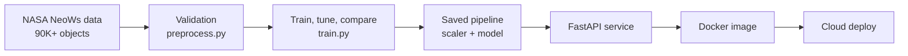

# NEO Sentinel


**Asteroid hazard screening API, trained on NASA's Near Earth Object catalog.**

Give it an asteroid's size, speed, miss distance and brightness. It returns the probability that NASA would classify the object as potentially hazardous, plus a risk tier an analyst can act on.

[](https://github.com/sidhantds/Neo-Sentinal/actions/workflows/tests.yml)


---

## Why I built this

NASA tracks tens of thousands of near Earth objects. Nobody can run a full orbital analysis on every one of them, so the real question is triage: which objects deserve a closer look first?

I wanted a project that goes past a notebook. Real data, an honest evaluation, and a service someone can actually call. NEO Sentinel is my attempt at the full machine learning lifecycle, end to end, the way it would run inside a team.

## What it does

```bash
curl -X POST http://localhost:8000/predict \
  -H "Content-Type: application/json" \
  -d '{"est_diameter_min":0.1,"est_diameter_max":0.25,"relative_velocity":45000,"miss_distance":5000000,"absolute_magnitude":21.5}'
```

```json
{
  "hazardous": false,
  "hazard_probability": 0.1342,
  "model_name": "xgboost",
  "risk_tier": "low"
}
```
*Example response shape. Actual values depend on your trained model.*

| Endpoint | Purpose |
|---|---|
| `GET /health` | Service status and whether a model is loaded |
| `POST /predict` | Hazard probability, label and risk tier (low, moderate, elevated, high) |
| `GET /model-info` | Model name, features, held out test metrics, feature importance |
| `GET /docs` | Interactive Swagger UI |

## How it works



**Data.** NASA Nearest Earth Objects dataset (NeoWs API via Kaggle), about 90,800 records. Five physical and orbital features: estimated diameter (min and max), relative velocity, miss distance, absolute magnitude. Identifiers and constant columns are dropped.

**Modeling.**
* Logistic Regression baseline, then Random Forest and XGBoost tuned with `RandomizedSearchCV`
* Stratified 70 / 15 / 15 train, validation and test split
* Best model picked on validation F1, refit on train plus validation, scored **once** on the untouched test set
* Class imbalance handled with class weights and `scale_pos_weight` rather than resampling
* Explainability through feature importance and an optional SHAP summary plot

**Engineering.**
* One shared preprocessing module used in both training and serving, so there is no training and serving skew
* Scaler and model saved together as a single `sklearn.Pipeline`, so the API can never pair the wrong scaler with the model
* Pydantic validation rejects bad input: negative values, missing fields, min diameter larger than max
* Returns a clean `503` if no model is trained yet instead of crashing
* 15 pytest tests covering validation rules and every API endpoint, run on every push through GitHub Actions
* Dockerfile that reads `$PORT`, ready for Render, Railway or any container platform

## Design decisions I made on purpose

**Recall over accuracy.** Hazardous objects are the minority class. A model that says "safe" every time scores high accuracy and is useless. For a screening tool, missing a dangerous asteroid costs far more than a false alarm, so I select on F1 and report recall on the hazardous class explicitly.

**No leakage.** Every feature is an observed property of the object itself. Nothing is derived from how NASA assigned the label.

**No invented numbers.** Every metric comes from `models/metrics.json`, which `train.py` writes after a real run. This README does not quote scores I have not produced.

**Honest scope.** This is a first pass screen, not a replacement for NASA's orbital hazard assessment. It does not model trajectory uncertainty or future perturbations.

## Run it yourself

```bash
git clone https://github.com/sidhantds/Neo-Sentinal.git
cd Neo-Sentinal
python -m venv .venv && source .venv/bin/activate   # Windows: .venv\Scripts\activate
pip install -r requirements.txt

python src/download_data.py              # needs a Kaggle API token, or download manually into data/neo.csv
python src/train.py --data data/neo.csv  # trains, compares models, writes models/

uvicorn app.main:app --reload            # open http://localhost:8000/docs
pytest tests/
```

**Docker**
```bash
docker build -t neo-sentinel .
docker run -p 8000:8000 neo-sentinel
```

**Optional Streamlit demo**
```bash
pip install -r requirements-ui.txt
API_URL=http://localhost:8000 streamlit run app/streamlit_app.py
```

## Project structure

```
app/
  main.py              FastAPI service
  schemas.py           Request and response models with validation
  streamlit_app.py     Simple demo UI
src/
  download_data.py     Pulls the NASA dataset from Kaggle
  preprocess.py        Shared validation and cleaning
  train.py             Baseline, tuning, comparison, test evaluation
tests/                 pytest suite (preprocessing + API)
docs/PROJECT_PLAN.md   Full design notes, dataset audit and deployment guide
Dockerfile
```

## What I learned

* Accuracy can lie on imbalanced data. Choosing the metric is a product decision, not a default.
* The split strategy matters as much as the model. Touching the test set once is a discipline, not a formality.
* Packaging the scaler with the model removed an entire class of bugs before they could happen.
* Writing tests for an ML service is mostly about validating inputs and contracts, and that is where real bugs hide.
* Shipping something people can call teaches more than tuning a notebook for another 0.5%.

## What I'm adding next

- [ ] Live deployment link with screenshots of `/docs` and a prediction
- [ ] Probability calibration and a threshold chosen from the cost of false negatives
- [ ] Pull fresh data straight from NASA's NeoWs API instead of a static CSV
- [ ] Model versioning and experiment tracking with MLflow
- [ ] Simple monitoring for input drift on live requests

## About me

I'm **Sidhant Pujara**, a BCA student at MIT World Peace University, Pune, and a Data Science Intern at GlobalLogic (Hitachi). I'm working toward AI engineering roles and I learn best by building complete systems, shipping them, and then improving what broke.

[Portfolio](https://sidhantpujara.vercel.app) · [LinkedIn](https://linkedin.com/in/sidhant-pujara) · [GitHub](https://github.com/sidhantds)

If you have feedback on this project, I'd genuinely like to hear it. Open an issue or reach out on LinkedIn.

---

*Data: NASA Open Data via NeoWs, compiled on Kaggle. NASA data is public domain.*
