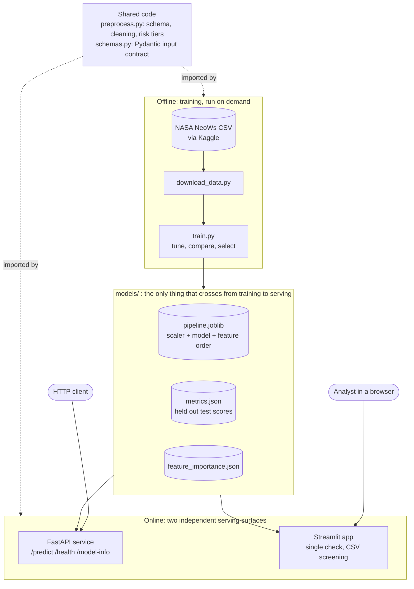

# NEO Sentinel

**Asteroid hazard screening, trained on NASA's Near Earth Object catalog. Served as a FastAPI service and an interactive Streamlit app.**

Give it an asteroid's size, speed, miss distance and brightness. It returns the probability that NASA would classify the object as potentially hazardous, plus a risk tier an analyst can act on.

[](https://github.com/sidhantds/Neo-Sentinal/actions/workflows/tests.yml)


---

## Why I built this

NASA tracks tens of thousands of near Earth objects. Nobody can run a full orbital analysis on every one of them, so the real question is triage: which objects deserve a closer look first?

I wanted a project that goes past a notebook. Real data, an honest evaluation, and a service someone can actually call. NEO Sentinel is my attempt at the full machine learning lifecycle, end to end, the way it would run inside a team.

## What it does

### Interactive app (Streamlit)

* **Check one object.** Enter size, speed, distance and brightness, or start from an example, and get a hazard probability with a risk tier and a plain language recommendation.
* **Screen a CSV.** Upload hundreds of objects, get them ranked by risk, and download the results.
* **How the model decides.** Feature importance, SHAP plot, and a side by side comparison of every model that was tried.

### API (FastAPI)


```bash
curl -X POST http://localhost:8000/predict \
  -H "Content-Type: application/json" \
  -d '{"est_diameter_min":0.1,"est_diameter_max":0.25,"relative_velocity":45000,"miss_distance":5000000,"absolute_magnitude":21.5}'
```

```json
{
  "hazardous": false,
  "hazard_probability": 0.1342,
  "model_name": "xgboost",
  "risk_tier": "low"
}
```
*Example response shape. Actual values depend on your trained model.*

| Endpoint | Purpose |
|---|---|
| `GET /health` | Service status and whether a model is loaded |
| `POST /predict` | Hazard probability, label and risk tier (low, moderate, elevated, high) |
| `GET /model-info` | Model name, features, held out test metrics, feature importance |
| `GET /docs` | Interactive Swagger UI |

## System design

### Architecture



The system has two halves that never call each other: **offline training** and **online serving**. The only thing that crosses the boundary is the set of files in `models/`. Solid arrows carry data. Dotted arrows show that training and both serving surfaces import the same validation and preprocessing code.

### What happens on one prediction

1. The request body is checked by the Pydantic model in `schemas.py`: every field present, sizes, speed and distance above zero, minimum diameter not larger than maximum. A bad request stops here with a `422`.
2. The API applies the cross field rule a second time through `preprocess.validate_prediction_input`. The Streamlit app validates through the same Pydantic model, so both surfaces reject exactly the same inputs.
3. The record becomes a one row DataFrame **in the column order saved inside the bundle**, not the order the client sent. A client that reorders JSON keys cannot silently feed the model the wrong feature.
4. The saved pipeline scales the row and returns a probability. The label uses a 0.5 cut, and `risk_tier` maps the probability to low, moderate, elevated or high.
5. Any unexpected failure is logged with a stack trace on the server and returned to the client as a plain error message, never as a raw trace.

### Design decisions and trade offs

| Decision | Why | Cost |
|---|---|---|
| Scaler and model saved as **one** `sklearn.Pipeline` | The API can never pair a model with the wrong scaler | Swapping only the model means retraining the whole pipeline |
| Feature order stored **inside** the artifact | The artifact describes its own input, so serving does not depend on hard coded column lists | Renaming a feature requires a new artifact |
| One `preprocess.py` for training and serving | Removes training and serving skew, the most common silent bug in deployed models | Training code and serving code cannot evolve separately |
| Model loaded **once** at startup through FastAPI's lifespan hook | No disk read per request; every request is a pure in memory computation | A new model needs a restart, so there is no hot swap |
| Starts **without** a model and returns `503` | `/health` reports `model_loaded`, which works as a readiness probe for a load balancer | A misconfigured deploy looks healthy unless the probe checks that field |
| Streamlit loads the artifact itself instead of calling the API | The two surfaces deploy and fail independently, and both run on free hosting | Two copies of the model in memory, and nothing guarantees both run the same version |
| Selection on validation F1, test set scored once | The reported test score is not inflated by tuning | The test set is only 15% of the data, so the score carries more noise |

### What the model is really learning

NASA defines a potentially hazardous asteroid using two numbers: absolute magnitude (H of 22 or brighter) and minimum orbit intersection distance (0.05 AU or closer). This dataset contains H, but **not** the orbit intersection distance. It only has the miss distance of one recorded close approach. The diameter estimates in NeoWs are also computed from H, so three of the five features carry largely the same information.

In practice the model mostly relearns the brightness rule and uses miss distance as a rough stand in for orbit geometry. That explains both why the scores are strong and where they will fail: an object that is bright enough but whose single recorded pass was distant can still be hazardous.

### Scaling

The service holds no state between requests, so it scales horizontally: run more containers behind a load balancer. Each prediction scores a single row, so the cost per request is small. For large workloads the next step is a batch endpoint that scores many rows in one `predict_proba` call, the same way the Streamlit CSV screen already does.

### Known gaps

* **Model artifacts are not in the repo.** `models/*.joblib` and `models/*.json` are in `.gitignore`, so the Docker image copies an empty `models/` folder and a fresh Streamlit Cloud deploy shows "No trained model found." The fix is to train inside the Docker build or in CI, or to publish the artifact as a release asset and download it at startup.
* **No model versioning.** The bundle records the model name, but not a version, training date or data hash, so you cannot tell which run is live.
* **Threshold not tuned.** The design favours recall, but the label still uses a fixed 0.5 cut. Choosing the threshold from validation recall would match the stated goal.
* **No monitoring.** Nothing records the inputs received in production, so drift away from the training data would go unnoticed.

### The model

**Data.** NASA Nearest Earth Objects dataset (NeoWs API via Kaggle), about 90,800 records. Five physical and orbital features: estimated diameter (min and max), relative velocity, miss distance, absolute magnitude. Identifiers and constant columns are dropped.

**Modeling.**
* Logistic Regression baseline, then Random Forest and XGBoost tuned with `RandomizedSearchCV`
* Stratified 70 / 15 / 15 train, validation and test split
* Best model picked on validation F1, refit on train plus validation, scored **once** on the untouched test set
* Class imbalance handled with class weights and `scale_pos_weight` rather than resampling
* Explainability through feature importance and an optional SHAP summary plot

**Testing and delivery.**
* 21 pytest tests covering validation, training, every API endpoint and the Streamlit app (run headless), on every push through GitHub Actions
* Dockerfile that reads `$PORT`, ready for Render, Railway or any container platform

## Design decisions I made on purpose

**Recall over accuracy.** Hazardous objects are the minority class. A model that says "safe" every time scores high accuracy and is useless. For a screening tool, missing a dangerous asteroid costs far more than a false alarm, so I select on F1 and report recall on the hazardous class explicitly.

**No leakage.** Every feature is an observed property of the object itself. Nothing is derived from how NASA assigned the label.

**No invented numbers.** Every metric comes from `models/metrics.json`, which `train.py` writes after a real run. This README does not quote scores I have not produced.

**Honest scope.** This is a first pass screen, not a replacement for NASA's orbital hazard assessment. It does not model trajectory uncertainty or future perturbations.

## Run it yourself

```bash
git clone https://github.com/sidhantds/Neo-Sentinal.git
cd Neo-Sentinal
python -m venv .venv && source .venv/bin/activate   # Windows: .venv\Scripts\activate
pip install -r requirements.txt

python src/download_data.py              # needs a Kaggle API token, or download manually into data/neo.csv
python src/train.py --data data/neo.csv  # trains, compares models, writes models/

uvicorn app.main:app --reload            # open http://localhost:8000/docs
pytest tests/
```

**Docker**
```bash
docker build -t neo-sentinel .
docker run -p 8000:8000 neo-sentinel
```

**Streamlit app**
```bash
streamlit run streamlit_app.py           # open http://localhost:8501
```

## Deploy the Streamlit app (free)

The app loads the trained model directly, so it needs no separate server.

1. Train locally, then commit the model files (they are ignored by default):
   ```bash
   python src/train.py --data data/neo.csv
   git add -f models/pipeline.joblib models/metrics.json models/feature_importance.json models/shap_summary.png
   git commit -m "Add trained model" && git push
   ```
2. Go to [share.streamlit.io](https://share.streamlit.io), sign in with GitHub, click **Create app**.
3. Repository `sidhantds/Neo-Sentinal`, branch `main`, main file `streamlit_app.py`.
4. Under **Advanced settings**, pick **Python 3.11** (the pinned libraries need it).
5. Deploy. You get a public link like `https://neo-sentinel.streamlit.app`.

## Project structure

```
app/
  main.py              FastAPI service
  schemas.py           Request and response models with validation
src/
  download_data.py     Pulls the NASA dataset from Kaggle
  preprocess.py        Shared validation and cleaning
  train.py             Baseline, tuning, comparison, test evaluation
tests/                 pytest suite (preprocessing, training, API, Streamlit)
streamlit_app.py       Interactive app: single check, batch CSV, model explanation
.streamlit/            App theme
docs/PROJECT_PLAN.md   Full design notes, dataset audit and deployment guide
Dockerfile
```

## What I learned

* Accuracy can lie on imbalanced data. Choosing the metric is a product decision, not a default.
* The split strategy matters as much as the model. Touching the test set once is a discipline, not a formality.
* Packaging the scaler with the model removed an entire class of bugs before they could happen.
* Writing tests for an ML service is mostly about validating inputs and contracts, and that is where real bugs hide.
* Shipping something people can call teaches more than tuning a notebook for another 0.5%.

## What I'm adding next

- [ ] Live Streamlit link and screenshots in this README
- [ ] Probability calibration and a threshold chosen from the cost of false negatives
- [ ] Pull fresh data straight from NASA's NeoWs API instead of a static CSV
- [ ] Model versioning and experiment tracking with MLflow
- [ ] Simple monitoring for input drift on live requests

## About me

I'm **Sidhant Pujara**, a BCA student at MIT World Peace University, Pune, and a Data Science Intern at GlobalLogic (Hitachi). I'm working toward AI engineering roles and I learn best by building complete systems, shipping them, and then improving what broke.

[Portfolio](https://sidhantpujara.vercel.app) · [LinkedIn](https://linkedin.com/in/sidhant-pujara) · [GitHub](https://github.com/sidhantds)

If you have feedback on this project, I'd genuinely like to hear it. Open an issue or reach out on LinkedIn.

---

*Data: NASA Open Data via NeoWs, compiled on Kaggle. NASA data is public domain.*
