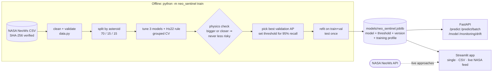
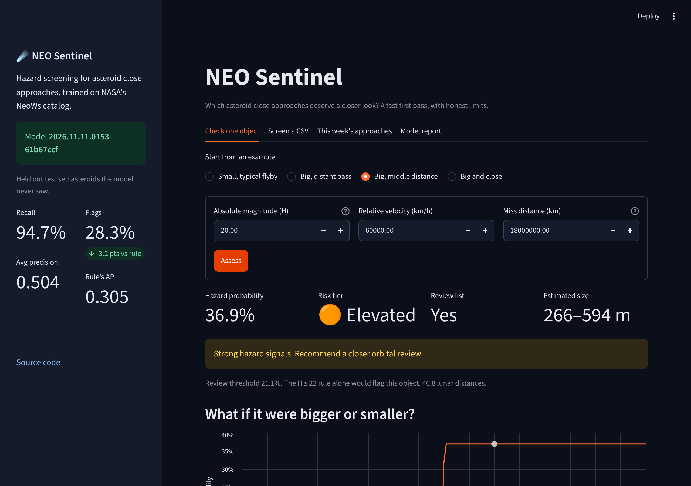
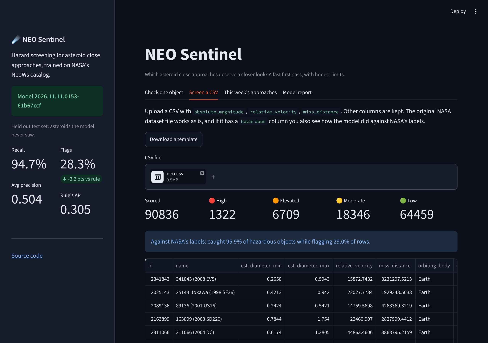
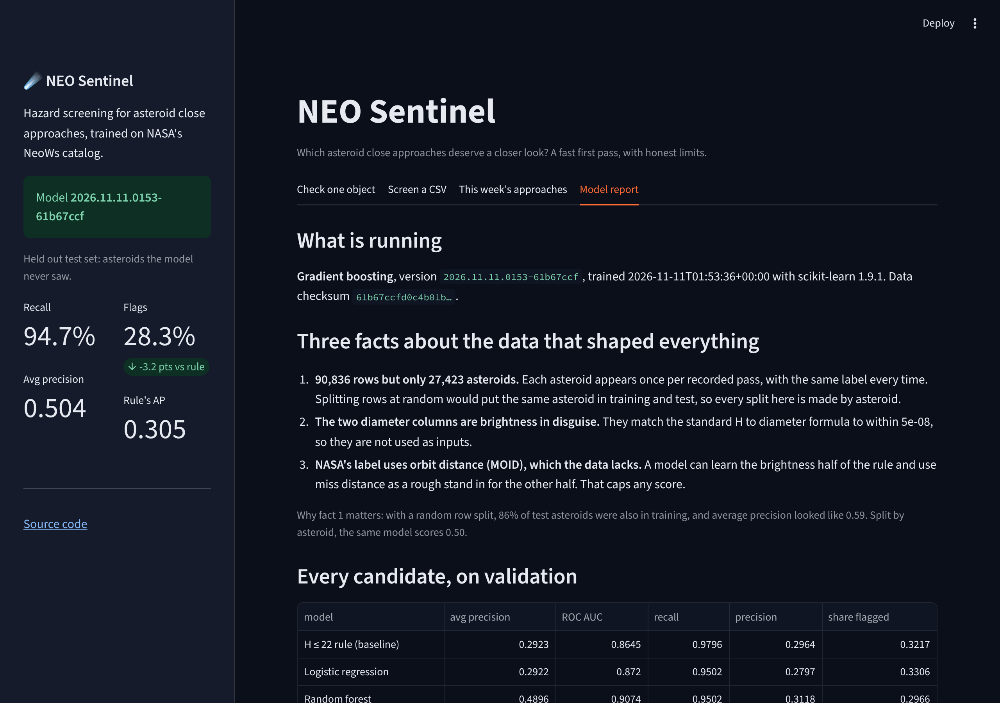

# NEO Sentinel

**Which asteroid close approaches deserve a closer look?** NEO Sentinel scores a near Earth object's close approach and returns a calibrated probability that NASA lists it as a potentially hazardous asteroid, plus a review decision and a risk tier. It is trained on NASA's NeoWs catalog and served as a FastAPI service and a Streamlit app, with a trained model included so both work right after cloning.

[](https://github.com/sidhantds/Neo-Sentinal/actions/workflows/tests.yml)


---

## Results

All numbers come from `models/model_card.json`, written by the training run. The test set is 4,114 asteroids the model never saw, scored once.

| On the test set | Avg precision | ROC AUC | Recall | Share of objects flagged | Hazardous missed | False alarms |
|---|---|---|---|---|---|---|
| NASA's H ≤ 22 brightness rule | 0.305 | 0.875 | 99.2% | 31.5% | 10 | 2,982 |
| **NEO Sentinel model** | **0.504** | **0.912** | 94.7% | **28.3%** | 71 | **2,607** |

**How to read this.** The model ranks risk far better than the rule (average precision 0.50 vs 0.30), and its probabilities are calibrated: objects it scores around 43% turn out hazardous 42% of the time. At the chosen review line it sends 375 fewer false alarms to analysts, but it also misses 61 more hazardous objects than the rule. So it does **not** replace the rule. It works best for **ordering the review queue**, so the riskiest objects get looked at first. If missing anything is unacceptable, raise the recall target (`--target-recall 0.99`) and the list grows to match.

## What I found in the data

Before modelling, I looked at the dataset. Three things changed how the project had to be built.

1. **90,836 rows, but only 27,423 asteroids.** Each asteroid appears once per recorded close approach (up to 43 times), always with the same label. A random row split, which is what most notebooks on this dataset use, put **86% of test asteroids into training too**, and inflated average precision from 0.50 to 0.59. Every split here is made by asteroid. Reproduce with `python -m neo_sentinel experiment`.
2. **The two diameter columns are brightness in disguise.** `est_diameter_min` and `est_diameter_max` match the standard formula `D = 1329 / sqrt(albedo) × 10^(−H/5)` to within 5 × 10⁻⁸, so they add nothing that H lacks. The model uses three inputs: absolute magnitude, velocity, and miss distance. The API still returns the diameter range, computed from H.
3. **NASA's label needs data this dataset doesn't have.** An asteroid is "potentially hazardous" if H ≤ 22 **and** its minimum orbit intersection distance (MOID) is ≤ 0.05 AU. The data has H but no MOID. The model can learn the brightness half of the rule (it puts a sharp step at H = 22 without being told) and use miss distance as a rough stand-in for MOID. That gap caps what any model on this data can score.

## How it decides



Both the API and the app score through the same `ModelBundle.score()`, so they cannot disagree.

### Decisions and trade-offs

| Decision | Why | Cost |
|---|---|---|
| Split, cross-validate and test **by asteroid** | Stops the model being graded on objects it already saw | The test score looks lower, because it's honest |
| Compare against the **H ≤ 22 rule** | A model that can't beat a one-line rule isn't worth deploying | None; it keeps everyone honest |
| **Physics check** before selection: making an object bigger, or its pass closer, must never lower its risk | Random forest scored 0.007 higher on validation but broke this for 8.5% of objects, so it was fitting noise | Gave up a little validation AP for answers that make physical sense |
| **Monotonic constraints** in gradient boosting | Builds the physics check into the model itself | Slightly less flexible |
| Imbalance handled by the **threshold**, not class weights | Keeps probabilities calibrated, so "30%" means about 3 in 10 | Threshold must be chosen on validation data |
| Threshold = smallest review list that reaches **95% recall on validation** | Missing a hazardous object costs more than a false alarm | Test recall came in at 94.7%, just under the 95% target, which is normal noise on a held-out set |
| **Model committed** to the repo (190 KB) | API, app and Docker image work on a fresh clone | The repo must be retrained when the code changes how models are built |
| Version, training time, data checksum and library versions **inside the bundle** | You can always tell which model is live | None |

## Run it

The trained model is in the repo, so you can start serving right away.

```bash
git clone https://github.com/sidhantds/Neo-Sentinal.git
cd Neo-Sentinal
python -m venv .venv && source .venv/bin/activate     # Windows: .venv\Scripts\activate
pip install -r requirements-dev.txt
```

```bash
uvicorn neo_sentinel.api.app:app --reload             # API docs at http://localhost:8000/docs
```

```bash
streamlit run streamlit_app.py                        # app at http://localhost:8501
```

```bash
pytest                                                # 55 tests, about 15 seconds
```

Or run both with Docker:

```bash
docker compose up --build
```

### Retrain from scratch

```bash
python -m neo_sentinel download      # fetches the CSV and rejects it unless the SHA-256 matches
python -m neo_sentinel train         # about 2 minutes; writes models/neo_sentinel.joblib and model_card.json
python -m neo_sentinel experiment    # leakage and approach history experiments
```

`download` tries Kaggle first (if you have an API token), then public GitHub copies of the same file. Any source is accepted only if its checksum matches.

### Score real asteroids from this week

```bash
export NASA_API_KEY=your_key         # free at https://api.nasa.gov; DEMO_KEY works but is rate limited
python -m neo_sentinel live
```

## API

| Endpoint | What it does |
|---|---|
| `POST /predict` | Score one close approach |
| `POST /predict/batch` | Score up to 1,000 at once, order preserved, with tier counts |
| `GET /model` | Full model card: version, data checksum, split, every candidate's scores, test results |
| `GET /monitoring/drift` | Compares recent inputs with the training data (PSI per feature): `stable`, `watch` or `drift` |
| `GET /health` | Readiness probe; `model_loaded` stays false until a model is found |

```bash
curl -X POST localhost:8000/predict -H "Content-Type: application/json" \
  -d '{"absolute_magnitude": 21.5, "relative_velocity": 45000, "miss_distance": 5000000}'
```

```json
{
  "hazard_probability": 0.9926,
  "flagged": true,
  "risk_tier": "high",
  "advice": "Very likely on NASA's hazardous list. Prioritise for full orbital analysis.",
  "estimated_diameter_km": {"min": 0.1332, "max": 0.2979},
  "brightness_rule_flag": true,
  "warnings": [],
  "model_version": "2026.11.11.0153-61b67ccf",
  "threshold": 0.2111
}
```

Inputs outside the training range are still scored, but come back with a plain-language warning. Unknown fields, impossible values and missing fields are rejected with `422`. Every response carries `X-Model-Version` and `X-Process-Time-Ms` headers.

| Setting | Effect |
|---|---|
| `NEO_MODEL_PATH` | Load a different model bundle |
| `NEO_PREDICTION_LOG` | Append every scored request to this JSONL file |
| `NEO_DRIFT_WINDOW` | How many recent inputs the drift check keeps (default 5,000) |

**Risk tiers.** *Low* is below the review threshold. Above it: *moderate* under 30%, *elevated* 30% to 60%, *high* 60% or more.

## The app



| Screen a CSV | Model report |
|---|---|
|  |  |

* **Check one object.** Pick an example or type values, get the probability, tier, estimated size and advice, plus a "what if it were bigger or smaller" curve that shows the jump at NASA's H = 22 line.
* **Screen a CSV.** Upload many objects (the original NASA file works as is) and download them ranked. If the file has NASA's labels, you also see how many hazardous objects were caught.
* **This week's approaches.** Pulls real close approaches from NASA's NeoWs feed, scores them, and puts NASA's own label next to each one.
* **Model report.** What's running, the data findings, every candidate compared, a calibration chart, and what the model relies on.

**Deploy free on Streamlit Community Cloud:** create an app from this repo with main file `streamlit_app.py` and Python 3.12. Optionally add `NASA_API_KEY` under *Secrets*. No training step is needed.

**Deploy the API** on Render, Railway or Fly: point it at the `Dockerfile`. The container reads `$PORT` and has a health check built in.

## Project layout

```
neo_sentinel/
  config.py        paths, feature list, settings
  physics.py       H to diameter, NASA's PHA thresholds, brightness rule
  data.py          download (checksum verified), validation, cleaning
  splitting.py     train / validation / test split by asteroid
  models.py        candidates, search spaces, H<=22 baseline
  metrics.py       evaluation, threshold choice, physics check, calibration
  train.py         the training pipeline; writes bundle + model card
  bundle.py        ModelBundle: the one object serving uses
  monitoring.py    training profile, PSI drift monitor, out of range warnings
  neows.py         live NASA NeoWs feed client
  experiments.py   split leakage and approach history experiments
  api/             FastAPI app and request/response schemas
streamlit_app.py   the app
models/            committed model, model card, experiment results
docs/images/       app screenshots used in this README
tests/             55 tests: data, splitting, metrics, training, API, app, NASA parser, shipped model
```

## Limits

* This is a triage aid, not NASA's hazard assessment. It does not model orbits, observation uncertainty or future perturbations.
* It sees one close approach at a time. The same asteroid can get different scores on different passes.
* NASA's label can change as orbits are refined. The model learned the labels as they were when the dataset was compiled.
* The drift monitor lives in memory and resets on restart. For a long-running service, ship `NEO_PREDICTION_LOG` to proper storage.

## What's next

- [ ] **Use each asteroid's approach history.** Adding its closest recorded pass, number of passes and top speed lifts test average precision from **0.50 to 0.74** (`models/experiment_history_features.json`). It means changing the API to take a history instead of one observation, and computing those features from NASA's full close-approach record rather than this dataset's time window.
- [ ] Retrain on the NeoWs browse API so the data stays current.
- [ ] Deploy to Streamlit Community Cloud and add the live link here.

## About me

I'm **Sidhant Pujara**, a BCA student at MIT World Peace University, Pune, and a Data Science Intern at GlobalLogic (Hitachi). I'm working toward AI engineering roles, and I learn best by building complete systems, shipping them, and then improving what broke.

[Portfolio](https://sidhantpujara.vercel.app) · [LinkedIn](https://linkedin.com/in/sidhant-pujara) · [GitHub](https://github.com/sidhantds)

---

*Data: NASA Open Data via NeoWs, compiled on Kaggle ([sameepvani/nasa-nearest-earth-objects](https://www.kaggle.com/datasets/sameepvani/nasa-nearest-earth-objects)). NASA data is public domain.*
